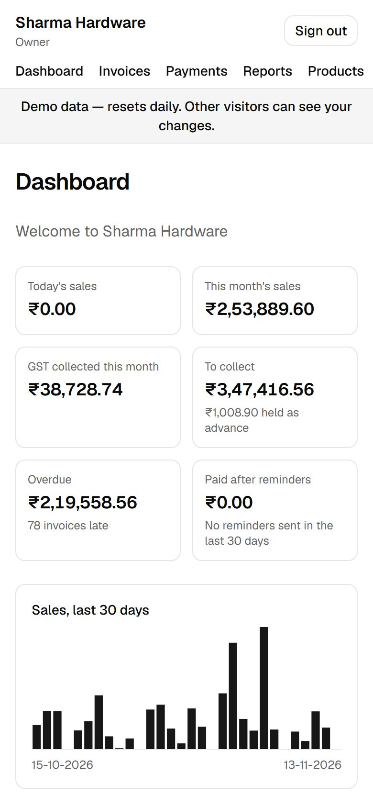
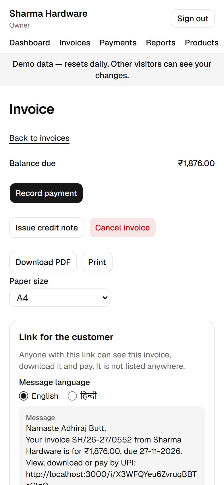
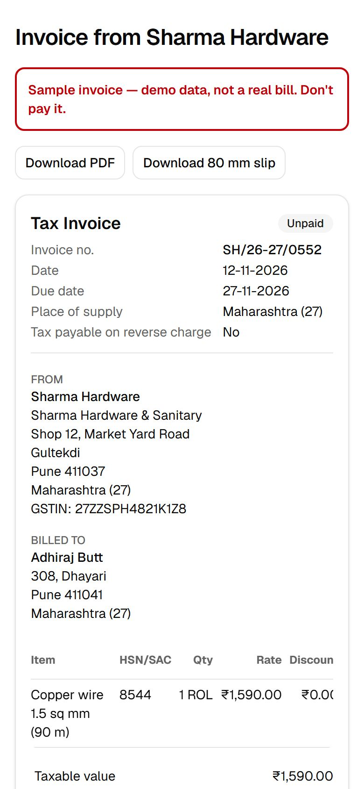
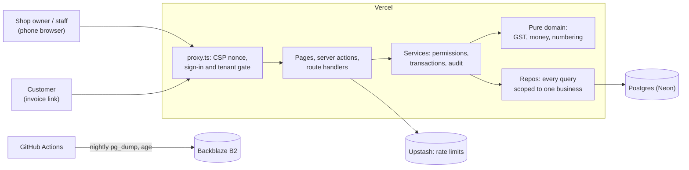

# Galla

GST billing and udhaar for small Indian shops. Create a GST-correct invoice in under a minute on a phone, share it on WhatsApp with a UPI QR, track who owes what, and hand your CA a one-click GST sales export.

- **Live demo:** https://galla-mu.vercel.app. Click **Try as the owner** or **Try as staff** to open _Sharma Hardware_, a sample shop with six months of invoices, payments and udhaar. No sign-up; it resets every morning.
- **2-minute video:** _to be recorded_
- **Spec:** [SPEC.md](SPEC.md) · **Engineering rules:** [CLAUDE.md](CLAUDE.md) · **Architecture:** [docs/architecture.md](docs/architecture.md) · **Decisions:** [docs/adr](docs/adr)

> **Status:** v1 is complete (Phases 0–12 of [BUILD_PLAN.md](BUILD_PLAN.md)). Next: real shops (Phase 13). Not tax or legal advice.

| Dashboard                                                                       | An invoice                                                | What the customer sees                                |
| ------------------------------------------------------------------------------- | --------------------------------------------------------- | ----------------------------------------------------- |
|  |  |  |

## What it does

- **Accounts and teams:** sign up with a password or an email code, set up a business (regular, composition or unregistered), and invite an accountant or staff, each with their own permissions.
- **Products and customers,** added by hand or imported from CSV with a preview. GSTIN checks fill the customer's state.
- **GST invoices on a phone:**
  - CGST and SGST, UTGST or IGST from the place of supply;
  - HSN checks, gapless numbers per financial year, and invoices that can't change once issued;
  - cancellations and credit notes for returns.
- **PDFs, A4 or 80 mm thermal,** with a UPI QR. Share on WhatsApp (English or Hindi message) or by email, with a private link where the customer sees the bill and pays by UPI.
- **Payments and udhaar:**
  - payments split oldest-first or by hand, advances and refunds;
  - each customer's ledger, statement and ageing;
  - WhatsApp reminders, and email reminders and an owner digest from a daily job.
- **Dashboard and reports:** sales, GST and money to collect; the sales register and HSN summary (CSV and Excel); a GSTR-1 helper workbook for the CA.
- **Activity log:** who changed what, and when.
- **Hardening:**
  - strict CSP with nonces, rate limits and tenant isolation tests;
  - accessibility checks on 14 pages;
  - Sentry without personal data;
  - nightly encrypted backups with a tested restore.

## Tech stack

Next.js 16 (App Router) · TypeScript (strict) · Tailwind CSS + shadcn/ui · next-intl · Drizzle ORM · PostgreSQL (Neon) · Better Auth · Upstash Redis · Resend · Sentry · Vitest + fast-check · Playwright · k6 · GitHub Actions · Vercel

## Architecture



More in [docs/architecture.md](docs/architecture.md): the data model, issuing, payments, the public link, the daily job and the demo reset.

**Key decisions** (all in [docs/adr](docs/adr)):

- money as integer paise, with one rounding rule ([0002](docs/adr/0002-integer-money.md));
- tenant isolation in the repo layer, backed by composite foreign keys ([0003](docs/adr/0003-tenant-isolation.md));
- gapless numbering and immutable invoices ([0006](docs/adr/0006-gapless-numbering-and-immutable-invoices.md));
- a strict CSP with nonces ([0015](docs/adr/0015-csp-with-nonces.md));
- a demo built by replaying the real services ([0018](docs/adr/0018-demo-business-and-daily-reset.md)).

## Run locally

Requires Node 24 (see `.nvmrc`), pnpm and Docker Desktop.

```bash
pnpm install
cp .env.example .env.local
pnpm db:up          # Postgres 16 in Docker (also creates the galla_test database)
pnpm db:migrate
pnpm db:seed        # states, tax rates, units + a local "dev-shop" business (safe to re-run)
pnpm db:seed:demo   # the demo shop, Sharma Hardware (about 40 s)
pnpm dev            # http://localhost:3000, health check at /api/health
```

Sign up at http://localhost:3000/signup, or try the demo from the sign-in page. Without `RESEND_API_KEY`, sign-in codes are printed in the `pnpm dev` terminal instead of emailed.

## Tests and checks

```bash
pnpm check              # lint, format check, typecheck, unit, integration and perf tests
pnpm test:unit          # Vitest, no infrastructure needed
pnpm test:integration   # Vitest against the galla_test database (needs pnpm db:up)
pnpm test:e2e           # Playwright, desktop and 360 px mobile, with axe accessibility checks
pnpm test:coverage      # unit + integration with the coverage gates (domain 100%, services 85%)
```

About 1,100 unit tests (with fast-check properties for the GST invariants), 550 integration tests against real Postgres (including a "different business → not found" test for every service function), and Playwright journeys at phone and desktop sizes. Commits follow [Conventional Commits](https://www.conventionalcommits.org/); a pre-commit hook runs ESLint and Prettier.

## Metrics

Lighthouse mobile (13.6.0, median of 3; details in [docs/hardening-checklist.md](docs/hardening-checklist.md)):

| Page                 | Performance | Accessibility |
| -------------------- | ----------- | ------------- |
| Landing              | 93          | 100           |
| Sign-in (production) | 83          | 100           |
| Dashboard            | 94          | 100           |
| Invoice page         | 90          | 100           |
| Public invoice       | 99          | 100           |

All pages except sign-in were measured on a local production build.

Load test (k6, through the real server actions, local production build; [docs/load-test.md](docs/load-test.md)):

| Users | Invoices in 60 s | p95 create draft | p95 issue | Failures |
| ----- | ---------------- | ---------------- | --------- | -------- |
| 10    | 355              | 189 ms           | 249 ms    | 0        |
| 50    | 687              | 3.2 s            | 2.6 s     | 0        |

Gapless invoice numbers held in every test shop. At 50 users the single local server process is the limit, not the database.

## Roadmap

Real shops first (Phase 13: onboard a few, measure time to issue and money recovered, ship what they ask for). After that, see [SPEC.md §11](SPEC.md#11-roadmap-after-v1).

[Privacy](https://galla-mu.vercel.app/privacy) · [Terms](https://galla-mu.vercel.app/terms)
