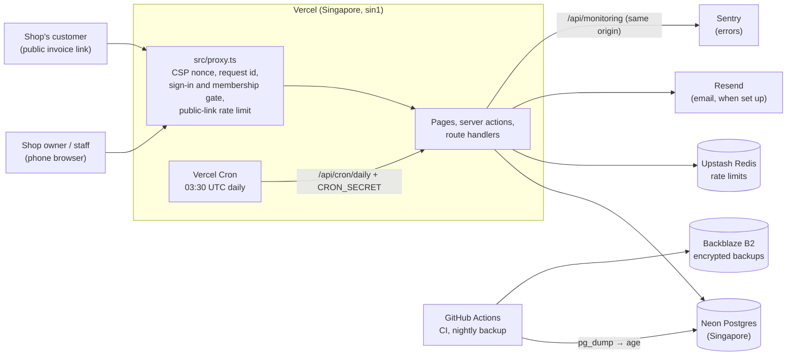
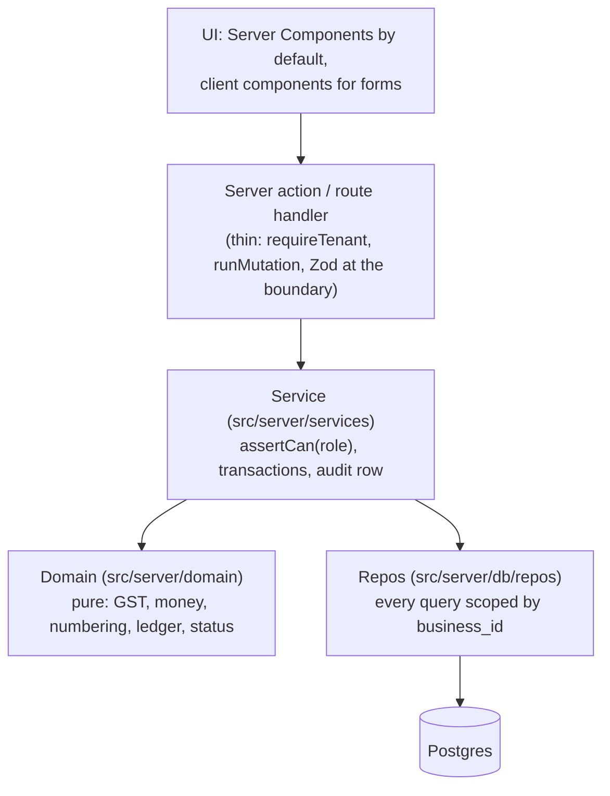
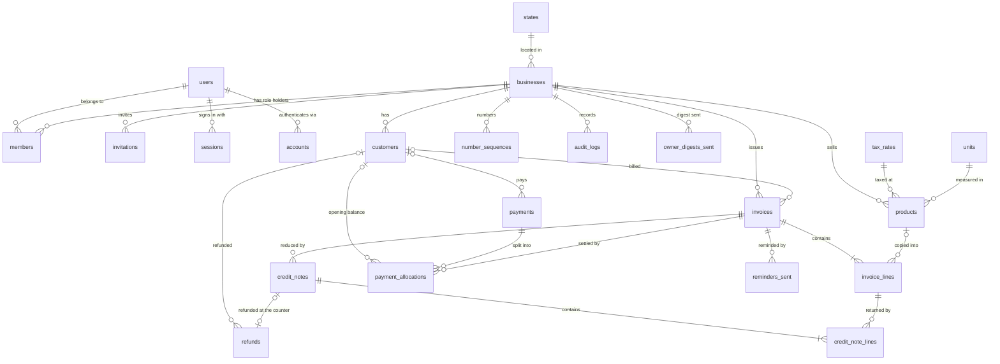
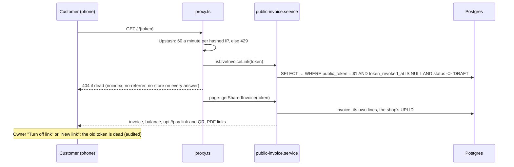

# Architecture

Galla is one Next.js app on Vercel with one Postgres database on Neon ([ADR 0001](adr/0001-nextjs-monolith-on-vercel.md)). This page shows how the pieces fit; the "why" of each choice is in the ADRs listed at the end, and the rules every change follows are in [CLAUDE.md](../CLAUDE.md).

## System context



- **Every request** to a page goes through the proxy first. It makes a per-request nonce for the strict CSP and passes on Vercel's request id. It sends signed-out visitors of `/b/*` to `/login`, and answers non-members of a business with a real 404 ([ADR 0015](adr/0015-csp-with-nonces.md), [ADR 0004](adr/0004-auth-and-tenancy.md)).
- **The browser only talks to our origin.** Error reports go to Sentry through `/api/monitoring`, which forwards them without cookies or IP ([ADR 0016](adr/0016-observability-without-pii.md)). PostHog analytics exist in code but are off; no key is set.
- **Outside services are optional where possible.** Without Resend, the "Email invoice" button and the daily emails are hidden or skipped. Without Sentry's key, nothing is sent. Upstash is required in production (rate limits), and in-memory elsewhere.

## Request flow and layers



- **Money** is integer paise (`bigint`), quantities are integer milli-units, rates are basis points: no floats anywhere ([ADR 0002](adr/0002-integer-money.md)). The server recomputes every total; the client's numbers are only a preview.
- **Tenant isolation** ([ADR 0003](adr/0003-tenant-isolation.md)): a `TenantContext` (user, business, role) comes only from `requireTenant`. Every repo function takes it and filters with `tenantScope`. Links between tenant tables are composite foreign keys (`business_id`, `x_id`). Each service function has a "different business → not found" integration test. Cross-tenant reads exist only in `src/server/db/admin/`, which only the daily job may import (ESLint).
- **Authorization** is in services (`assertCan(ctx, "invoice:issue")`), not only in the UI. The roles are OWNER, ACCOUNTANT and STAFF (SPEC §3).
- **Financial changes** write an `audit_logs` row in the same transaction (shown on the Activity page, SPEC F11). Every server action that changes data counts against 120 a minute per user.
- **Dates** are business dates in Asia/Kolkata. Timestamps are stored in UTC, and the financial year runs April–March.

## The daily job

Vercel Cron calls `/api/cron/daily` at 03:30 UTC (09:00 IST) with `CRON_SECRET` ([ADR 0014](adr/0014-daily-job.md)). For each business, in batches of 25 and within 45 s, it sends due payment reminders (if the owner turned them on) and the owner's digest. Each is claimed first (`INSERT … ON CONFLICT DO NOTHING`), so running it twice sends nothing twice. Without Resend it reports `emailSetUp: false` and sends nothing.

## Backups

GitHub Actions runs at 21:30 UTC (03:00 IST). It dumps production with `pg_dump`, encrypts the dump with `age` to the owner's public key, and uploads it to a private Backblaze B2 bucket that keeps 30 days ([ADR 0017](adr/0017-nightly-backups.md), [restore steps](restore.md)). Neon's own point-in-time restore covers the last 6 hours on the free plan.

## Decisions (ADRs)

| ADR                                                           | Decision                                                                |
| ------------------------------------------------------------- | ----------------------------------------------------------------------- |
| [0001](adr/0001-nextjs-monolith-on-vercel.md)                 | One Next.js app on Vercel, Postgres on Neon                             |
| [0002](adr/0002-integer-money.md)                             | Integer money, one rounding rule, pure GST engine                       |
| [0003](adr/0003-tenant-isolation.md)                          | Tenant isolation in the repo layer, backed by composite foreign keys    |
| [0004](adr/0004-auth-and-tenancy.md)                          | Better Auth for identity and membership, Galla services for businesses  |
| [0005](adr/0005-csv-import.md)                                | CSV import with a preview, a second check and an all-or-nothing commit  |
| [0006](adr/0006-gapless-numbering-and-immutable-invoices.md)  | Gapless numbering at issue, and immutable invoices                      |
| [0007](adr/0007-credit-notes-by-returned-quantity.md)         | Credit notes by returned quantity, and when an invoice can be cancelled |
| [0008](adr/0008-pdf-with-react-pdf.md)                        | Invoice PDFs with react-pdf, rendered on demand                         |
| [0009](adr/0009-public-invoice-links.md)                      | Public invoice links                                                    |
| [0010](adr/0010-payments-allocation-and-ledger.md)            | Payments, allocation and the udhaar ledger                              |
| [0011](adr/0011-credit-notes-on-paid-invoices-and-refunds.md) | Credit notes on paid invoices, and refunds                              |
| [0012](adr/0012-reports-files-and-charts.md)                  | Report files and charts without heavy libraries                         |
| [0013](adr/0013-gstr1-helper.md)                              | The GSTR-1 helper workbook                                              |
| [0014](adr/0014-daily-job.md)                                 | The daily job, idempotent sends and cross-tenant reads                  |
| [0015](adr/0015-csp-with-nonces.md)                           | A strict CSP with nonces, and every page rendered per request           |
| [0016](adr/0016-observability-without-pii.md)                 | Error tracking and product analytics without personal data              |
| [0017](adr/0017-nightly-backups.md)                           | Nightly encrypted backups to Backblaze B2                               |

## Data model

Defined in `src/server/db/schema/`, created by the migrations in `drizzle/`.



- **Auth tables** (`users`, `sessions`, `accounts`, `verifications`, `members`, `invitations`) are written by Better Auth. `members` gives a user one role (`OWNER`, `ACCOUNTANT`, `STAFF`) in a business.
- **Reference tables** (`states`, `tax_rates`, `units`) are shared by all businesses and seeded by `pnpm db:seed:reference`, which also runs in every Vercel build.
- **Tenant tables** all have `id` (UUIDv7), `business_id`, `created_at`, `updated_at`, `created_by` (`audit_logs` uses `at` and `actor_user_id`). Money is `bigint` paise, quantity is `bigint` milli-units, rates are `integer` basis points.
- **Links between tenant tables are composite** (`business_id`, `x_id`), so a row can only point inside its own business.
- **Issued documents are snapshots:** invoice and credit-note lines copy description, HSN, unit, price and rate, and the invoice stores the customer and the business as printed, so later edits never change a past invoice. Database triggers refuse changes to issued invoices and to credit notes (ADR 0006).

## Issuing an invoice

A draft is a JSON working copy on the invoice row; issuing turns it into numbered, immutable rows in one transaction ([ADR 0006](adr/0006-gapless-numbering-and-immutable-invoices.md)).

```mermaid
sequenceDiagram
  participant UI as Builder (client)
  participant S as invoice.service
  participant DB as Postgres
  UI->>S: updateDraft(version, draft) (autosave, no totals)
  S->>DB: UPDATE invoices … WHERE status = 'DRAFT' AND version = v
  UI->>S: issueInvoice(id, version, acknowledgedWarnings)
  S->>DB: BEGIN; SELECT invoice … FOR UPDATE
  S->>DB: load business, customer, products (tenant-scoped)
  S->>S: recompute lines and totals, check issue rules
  S->>DB: INSERT invoice_lines (snapshots)
  S->>DB: INSERT … ON CONFLICT DO UPDATE number_sequences RETURNING n
  S->>DB: UPDATE invoices SET status = 'ISSUED', number, snapshots, token
  S->>DB: INSERT audit_logs; COMMIT
  Note over DB: triggers refuse later changes to issued rows
```

`OVERDUE` (due date before today in IST, money still owed) and `CREDITED` are shown, never stored (`src/server/domain/invoice/status.ts`).

## Recording a payment

A payment is split over the customer's open items, oldest first or as chosen; the rest stays on account ([ADR 0010](adr/0010-payments-allocation-and-ledger.md)). Every money change on a customer takes the same locks in the same order, so they never deadlock.

```mermaid
sequenceDiagram
  participant UI as Record payment (client)
  participant S as payment.service
  participant DB as Postgres
  UI->>S: recordPayment(customer, amount, date, mode, allocation) (no balances)
  S->>DB: BEGIN; SELECT customer … FOR UPDATE
  S->>DB: SELECT open invoices … ORDER BY id FOR UPDATE
  S->>DB: sums of allocations (opening balance, money on account)
  S->>S: autoAllocate or checkManualAllocation (pure domain)
  S->>DB: INSERT payments, payment_allocations
  S->>DB: UPDATE invoices SET amount_paid, status (settledStatus)
  S->>DB: INSERT audit_logs; COMMIT
  Note over DB: deferred trigger at commit: allocations ≤ payment, paid = Σ allocations
```

Voiding (owner only) takes the customer, the payment, then its invoices, marks the payment voided and lowers each invoice's amount paid. The customer ledger and aging are pure functions over the live documents (`src/server/domain/ledger/`).

## The public invoice link

A customer opens `/i/{token}` without an account. The token is the only key, so this is the one lookup that doesn't start from a `TenantContext` ([ADR 0009](adr/0009-public-invoice-links.md)).



## Code layers for data access

```
services ──▶ src/server/db/repos/*   (every function takes a TenantContext, filters via tenantScope)
         ──▶ src/server/db/transaction.ts   (withTransaction; pass tx to each repo call)
jobs     ──▶ src/server/db/admin/*   (cross-tenant; jobs and demo reset only)
```

ESLint keeps `drizzle-orm` and the schema out of every other folder.
