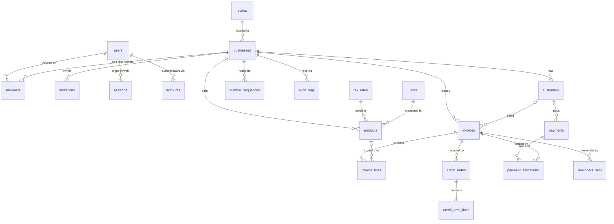

# Architecture

The full write-up comes in Phase 11. Until then, see [SPEC.md §7](../SPEC.md#7-architecture), [ADR 0001](adr/0001-nextjs-monolith-on-vercel.md) (one Next.js app on Vercel), [ADR 0002](adr/0002-integer-money.md) (integer money) and [ADR 0003](adr/0003-tenant-isolation.md) (tenant isolation), [ADR 0004](adr/0004-auth-and-tenancy.md) (sign-in and memberships) and [ADR 0005](adr/0005-csv-import.md) (CSV import).

## Data model

Defined in `src/server/db/schema/`, created by the migrations in `drizzle/`.



- **Auth tables** (`users`, `sessions`, `accounts`, `verifications`, `members`, `invitations`) are written by Better Auth. `members` gives a user one role (`OWNER`, `ACCOUNTANT`, `STAFF`) in a business.
- **Reference tables** (`states`, `tax_rates`, `units`) are shared by all businesses and seeded by `pnpm db:seed:reference`, which also runs in every Vercel build.
- **Tenant tables** all have `id` (UUIDv7), `business_id`, `created_at`, `updated_at`, `created_by` (`audit_logs` uses `at` and `actor_user_id`). Money is `bigint` paise, quantity is `bigint` milli-units, rates are `integer` basis points.
- **Links between tenant tables are composite** (`business_id`, `x_id`), so a row can only point inside its own business.
- **Issued documents are snapshots:** invoice and credit-note lines copy description, HSN, unit, price and rate, and the invoice stores the customer as printed, so later edits never change a past invoice.

## Code layers for data access

```
services ──▶ src/server/db/repos/*   (every function takes a TenantContext, filters via tenantScope)
         ──▶ src/server/db/transaction.ts   (withTransaction; pass tx to each repo call)
jobs     ──▶ src/server/db/admin/*   (cross-tenant; jobs and demo reset only)
```

ESLint keeps `drizzle-orm` and the schema out of every other folder.
