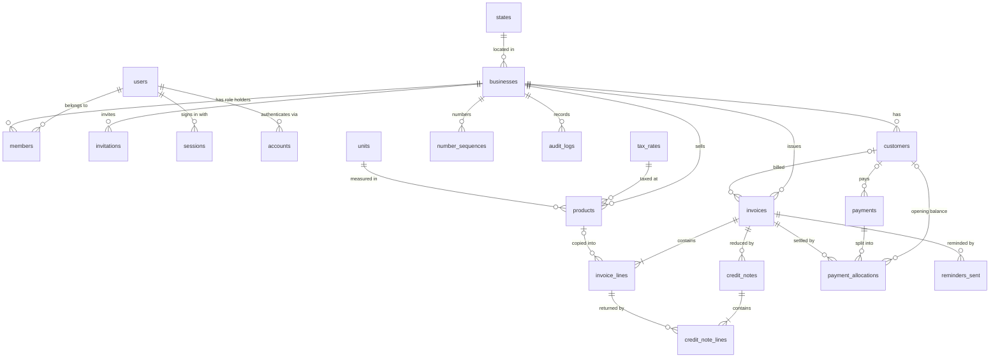
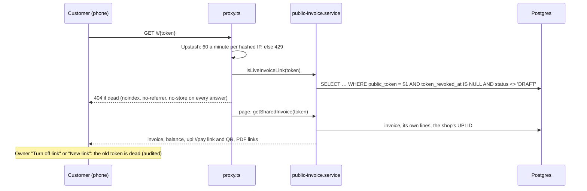

# Architecture

The full write-up comes in Phase 11. Until then, see [SPEC.md §7](../SPEC.md#7-architecture), [ADR 0001](adr/0001-nextjs-monolith-on-vercel.md) (one Next.js app on Vercel), [ADR 0002](adr/0002-integer-money.md) (integer money) and [ADR 0003](adr/0003-tenant-isolation.md) (tenant isolation), [ADR 0004](adr/0004-auth-and-tenancy.md) (sign-in and memberships) and [ADR 0005](adr/0005-csv-import.md) (CSV import) [ADR 0006](adr/0006-gapless-numbering-and-immutable-invoices.md) (numbering and immutable invoices) and [ADR 0007](adr/0007-credit-notes-by-returned-quantity.md) (credit notes).

## Data model

Defined in `src/server/db/schema/`, created by the migrations in `drizzle/`.



- **Auth tables** (`users`, `sessions`, `accounts`, `verifications`, `members`, `invitations`) are written by Better Auth. `members` gives a user one role (`OWNER`, `ACCOUNTANT`, `STAFF`) in a business.
- **Reference tables** (`states`, `tax_rates`, `units`) are shared by all businesses and seeded by `pnpm db:seed:reference`, which also runs in every Vercel build.
- **Tenant tables** all have `id` (UUIDv7), `business_id`, `created_at`, `updated_at`, `created_by` (`audit_logs` uses `at` and `actor_user_id`). Money is `bigint` paise, quantity is `bigint` milli-units, rates are `integer` basis points.
- **Links between tenant tables are composite** (`business_id`, `x_id`), so a row can only point inside its own business.
- **Issued documents are snapshots:** invoice and credit-note lines copy description, HSN, unit, price and rate, and the invoice stores the customer and the business as printed, so later edits never change a past invoice. Database triggers refuse changes to issued invoices and to credit notes (ADR 0006).

## Issuing an invoice

A draft is a JSON working copy on the invoice row; issuing turns it into numbered, immutable rows in one transaction ([ADR 0006](adr/0006-gapless-numbering-and-immutable-invoices.md)).

```mermaid
sequenceDiagram
  participant UI as Builder (client)
  participant S as invoice.service
  participant DB as Postgres
  UI->>S: updateDraft(version, draft) (autosave, no totals)
  S->>DB: UPDATE invoices … WHERE status = 'DRAFT' AND version = v
  UI->>S: issueInvoice(id, version, acknowledgedWarnings)
  S->>DB: BEGIN; SELECT invoice … FOR UPDATE
  S->>DB: load business, customer, products (tenant-scoped)
  S->>S: recompute lines and totals, check issue rules
  S->>DB: INSERT invoice_lines (snapshots)
  S->>DB: INSERT … ON CONFLICT DO UPDATE number_sequences RETURNING n
  S->>DB: UPDATE invoices SET status = 'ISSUED', number, snapshots, token
  S->>DB: INSERT audit_logs; COMMIT
  Note over DB: triggers refuse later changes to issued rows
```

`OVERDUE` (due date before today in IST, money still owed) and `CREDITED` are shown, never stored (`src/server/domain/invoice/status.ts`).

## Recording a payment

A payment is split over the customer's open items, oldest first or as chosen; the rest stays on account ([ADR 0010](adr/0010-payments-allocation-and-ledger.md)). Every money change on a customer takes the same locks in the same order, so they never deadlock.

```mermaid
sequenceDiagram
  participant UI as Record payment (client)
  participant S as payment.service
  participant DB as Postgres
  UI->>S: recordPayment(customer, amount, date, mode, allocation) (no balances)
  S->>DB: BEGIN; SELECT customer … FOR UPDATE
  S->>DB: SELECT open invoices … ORDER BY id FOR UPDATE
  S->>DB: sums of allocations (opening balance, money on account)
  S->>S: autoAllocate or checkManualAllocation (pure domain)
  S->>DB: INSERT payments, payment_allocations
  S->>DB: UPDATE invoices SET amount_paid, status (settledStatus)
  S->>DB: INSERT audit_logs; COMMIT
  Note over DB: deferred trigger at commit: allocations ≤ payment, paid = Σ allocations
```

Voiding (owner only) takes the customer, the payment, then its invoices, marks the payment voided and lowers each invoice's amount paid. The customer ledger and aging are pure functions over the live documents (`src/server/domain/ledger/`).

## The public invoice link

A customer opens `/i/{token}` without an account. The token is the only key, so this is the one lookup that doesn't start from a `TenantContext` ([ADR 0009](adr/0009-public-invoice-links.md)).



## Code layers for data access

```
services ──▶ src/server/db/repos/*   (every function takes a TenantContext, filters via tenantScope)
         ──▶ src/server/db/transaction.ts   (withTransaction; pass tx to each repo call)
jobs     ──▶ src/server/db/admin/*   (cross-tenant; jobs and demo reset only)
```

ESLint keeps `drizzle-orm` and the schema out of every other folder.
